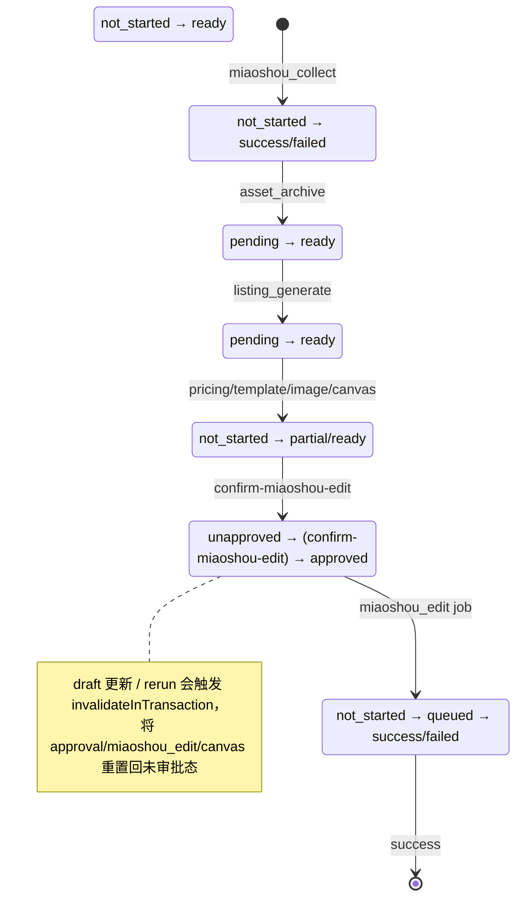

# 跨境电商采集与处理工作台 (tk-commerce-workbench) 系统设计

> **版本**：v2.0.0（以真实源码重建）
> **更新时间**：2026-08-11
> **证据来源**：`packages/*/src`、`apps/*/src`、`0000_initial.ts`、17 个 route.ts

---

## 1. 系统定位

本地单机运行的跨境电商商品自动化工作台：通过 Chrome MV3 扩展从 1688 抓取商品 → 后台 Worker 执行清洗/翻译/定价/图集渲染 → 操作员审批 → 回写妙手 ERP。**全部接口仅监听回环地址**，是面向单操作员的本地产线，而非公网多租户 SaaS。

### 核心安全基线
- 所有 API 仅接受 loopback 来源（`rejectNonLoopback`）；
- 浏览器发起的写操作需通过 `rejectUnsafeBrowserMutation`（防 CSRF）；
- 扩展采集需 `EXTENSION_TOKEN`；
- 源图经 `/api/v1/assets/[assetId]/content` 安全代理（realpath 防穿越 + 扩展名白名单 + SSRF 拒绝重定向）。

---

## 2. Monorepo 分层

```
apps/
  extension/   Chrome MV3：content scripts 抓取 1688 页 → background SW → POST 本地 API
  web/         Next.js 16 App Router：工作台 UI + /api/v1 REST（17 端点）+ server services
  worker/      后台任务引擎：轮询 jobs 表执行 12 类 handler
packages/
  contracts/   零依赖强类型契约：ids/states/commands/read-models/jobs/ports/errors
  config/      环境变量 + 手写 helper 校验（env.ts：require_/parseIntStrict/ensureLoopbackUnlessAllowLan，无 zod）
  domain/      纯领域函数：pricing/quality/revision/approval(graph/listing/templates/assets)
  db/          Drizzle 类型镜像 + 22 表 SQL 契约 + 10 个 repository（含 PipelineRepository）
  adapters/    miaoshou / canvas / llm / exchange-rate / staging / security / factory / testing
```

---

## 3. 数据模型核心：22 张表

唯一权威为 `0000_initial.ts`（详见《数据字典 v2》）。此处仅列关键结构：

- **`products`**：主商品，**7 个独立状态列**：
  `state_source / state_asset_archive / state_listing / state_canvas / state_approval / state_miaoshou_edit / state_automation`。
- **`product_revisions`**：不可变版本，`source_payload`(JSONB) + `working_draft`(JSONB)，`UNIQUE(product_id, draft_version)`。
- **`approval_snapshots`**：冻结的完整上架内容（标题/描述/属性/价格/图集顺序/模板版本），`NULLS NOT DISTINCT` 五元组唯一约束保证幂等。
- **`miaoshou_syncs`**：一次审批对应一次回写，`UNIQUE(approval_snapshot_id)`。
- **`jobs`**：任务队列，`lease_token/owner/lease_expires_at` 实现 Worker 抢占与租约，`UNIQUE(kind, business_key)` 幂等。
- **`assets`**：媒体资产，`kind` ∈ {`main`/`sku`/`detail`/`generated`…}，含 `perceptual_hash/clarity/watermark_probability/visual_score/chosen_role/rejection_reason` 评分体系。
- **`templates`**：Canvas 渲染模板，`template_key + version` 多版本族。

---

## 4. 后台 Worker：12 类 Job

真实 Job 类型定义于 `packages/contracts/src/jobs.ts`（`JobKind`，共 12 种）。注意：**handler 文件名 ≠ Job kind**（如 kind `asset_archive` 由 `archive-assets.ts` 处理）。

| Job kind | handler 文件 | 主要写入 |
|:---|:---|:---|
| `miaoshou_collect` | `collect.ts` | products/product_revisions/miaoshou_source_records |
| `asset_archive` | `archive-assets.ts` | assets |
| `listing_generate` | `generate-listing.ts` | listing_drafts |
| `pricing_calculate` | `calculate-pricing.ts` | pricing_runs |
| `template_match` | `match-template.ts` | working_draft.templateMatch |
| `image_select` | `select-images.ts` | working_draft.imageSelection |
| `exchange_rate_refresh` | `refresh-exchange-rate.ts` | exchange_rate_snapshots |
| `canvas_generate` | `generate-canvas.ts` | canvas_runs + assets(generated) |
| `final_preview` | `final-preview.ts` | 读 revisions/canvas 产出 |
| `miaoshou_prepare_writeback` | `prepare-miaoshou-writeback.ts` | 准备回写内容 |
| `miaoshou_edit` | `miaoshou-edit.ts` | miaoshou_syncs |
| `staging_cleanup` | `staging-cleanup.ts` | 清理暂存 |

Worker 通过 `jobs.lease_token + owner + lease_expires_at` 领取任务（`UPDATE ... WHERE status='queued'` 原子抢占），`attempt/max_attempts/next_attempt_at` 控制重试，`pause_reason` 支持暂停。

---

## 5. 核心链路

### 5.1 采集 → 草稿（两条路径）

**路径 A：本地扩展采集（`POST /api/v1/local-captures`）** — 同步写库，**不入队 Job**：
```
扩展 content script（1688 页抓取）
  → background SW 汇总 payload
  → POST /api/v1/local-captures（EXTENSION_TOKEN 校验，version 协商）
  → IngestService.ingestLocal → LocalCaptureRepository.save()
  → 直接写入 local_operators + products（state_source='local_captured'）+ product_revisions(draft 1)
  （不写 miaoshou_source_records、不入队 miaoshou_collect）
```

**路径 B：手动链接（`POST /api/v1/ingest-links`）** — 异步入队：
```
  → POST /api/v1/ingest-links（EXTENSION_TOKEN 校验）
  → IngestService.ingest → 入队 miaoshou_collect Job
  → worker collect handler 写 products + product_revisions + miaoshou_source_records
```

### 5.2 自动化清洗管线（PipelineRepository 门面按序写入）
```
collect → archive → listing → pricing → templates(match) → images(select) → canvas → finalPreview
```
每步在 `jobs` 租约围栏（withFence）内事务提交；`working_draft` 逐步累积 `pricingInputs/templateMatch/imageSelection/finalAssetOrder`。

### 5.3 审批与妙手回写（本项目的真实形态）
1. 操作员在工作台核对后，前端调用 **`POST /api/v1/products/[productId]/confirm-miaoshou-edit`**（`ConfirmMiaoshouEditV1`）→ 生成 `approval_snapshots` + `miaoshou_syncs`，返回 `{approvalSnapshotId, syncId}`。回写前用 `node assert` 校验 `orderedFinalAssetIds`（缺失 → `AssertionError` → `500 confirmation_failed`；`503 approval_mapping_not_ready` 在此端点不可达，仅由 batch-actions 逐项返回）。
2. **审批失效**不是独立端点，而是内建于写操作：`draft` 更新（`product_draft_overrides_updated`）或 `rerun`（`downstream_rerun_requested`）在事务内调用 `approvalInvalidation.invalidateInTransaction` 置 `state_approval='unapproved'`。
3. **无变更重试**：`POST /api/v1/products/[productId]/retry-miaoshou-edit` 在远端已成功但本地丢失时恢复，返回 `{approvalSnapshotId, syncId, jobId}`；受保护状态（`retry_not_allowed/revision_changed/writeback_in_progress` → 409）。
4. 批量操作：`POST /api/v1/products/batch-actions`（`confirm_miaoshou_edit` | `retry_from_failure`），逐商品返回 `{results:[{productId, ok, code?}]}`。

### 5.4 商品状态机（真实：7 状态列）



---

## 6. 域名与契约

- **`@tk/domain`**：纯函数模块（`pricing/calculate-price`、`product/quality+revision`、`state/project-ui-stage`、`listing/generate-listing`、`assets/score-image+select-canvas-inputs`、`templates/match-template`、`automation/graph`、`approval/create-snapshot+invalidate-approval`）。
- **`@tk/contracts`**：命令体（`IngestLocalCapturesV3`、`IngestLinksV1`、`RerunDownstreamV1`、`ConfirmMiaoshouEditV1`、`StartAutomationV1`、`UpdateProductOverridesV1`）、读模型（`MiaoshouSyncStatusV1` 等）、Job 枚举、状态枚举与错误码。
- **`@tk/adapters`**：外部能力防腐层。`EXTERNAL_ADAPTER_MODE`（`mock`/`live`，来自 `workspace_settings.external_adapter_mode`）决定走 fakes 还是真实服务。

---

## 7. 配置（`workspace_settings` 单行 + `.env`）

- **`.env`**：`DATABASE_URL/TEST_DATABASE_URL/LOCAL_OPERATOR_ID/EXTENSION_TOKEN/ALLOW_LAN/EXTERNAL_ADAPTER_MODE`（由 `@tk/config` 的手写 helper 校验，**非 zod**）。
- **`workspace_settings`**：`external_adapter_mode`、`worker_concurrency`、`max_canvas_runs_per_day`、`pricing_defaults`（费率/尾数）、`provider_options`（listingProvider/canvasWorkflow）、`retry_policy`、`worker_paused`。
- 设置更新走 `PATCH /api/v1/settings`，`expectedVersion` 乐观锁冲突 → 409。

---

## 8. 测试策略

- **单元/组件**（vitest）：domain 纯函数 + web 组件（实测 **94 个** `*.test.ts(x)` 文件）。
- **集成**：`packages/db` 用 PGlite 跑 `INITIAL_SQL` 验证 repository；`apps/worker` handler 测试。
- **E2E**（playwright）：`full-mocked-flow`、`worker-recovery`、`browser-workbench`、`ui-context`、`workbench-fixed-samples`、`collection-to-product-pool`。
- 统一入口：`pnpm test` → `scripts/run-tests.mjs`；`pnpm test:e2e`。
