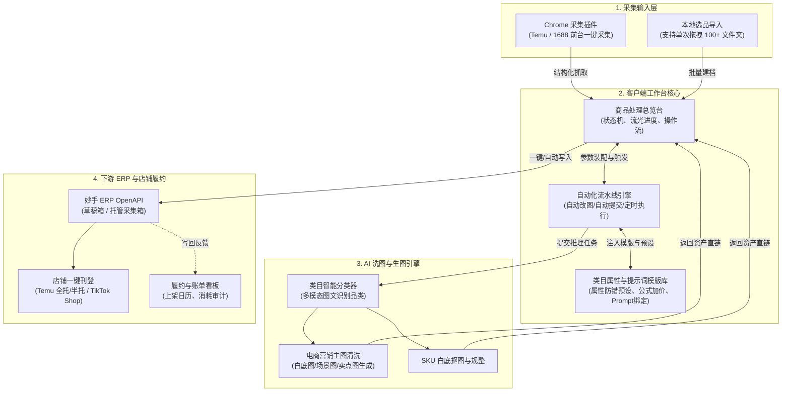

# 对标产品（海淘上架助手 / 库库上架）系统设计与落地方案

> **文档状态**：已归档 / 演进基准  
> **对标标的**：海淘上架助手 v1.1.8A（又称“库库上架系统”，基于 Mac/Windows 客户端 + Chrome 扩展 + 妙手 ERP）  
> **适用项目**：`tk-commerce-workbench` 跨境电商自动化工作台  
> **版本**：v1.0.0 (2026-10-01)

---

## 1. 业务定位与核心价值

### 1.1 业务背景

在 Temu（全托管/半托管）和 TikTok Shop 等跨境电商平台的日常经营中，卖家上架商品面临极高的劳动密集度痛点：

1. **修图制图慢**：需下载货源图，手动去中文水印、调色、更换场景，单品耗时 15~30 分钟。
2. **ERP 刊登校验频频阻断**：源头（1688 / 拼多多等）商品属性残缺、估重乱填（如 `0.001kg`）、库存虚高（如几十万件），导致同步到妙手 ERP 时被强校验拦截。
3. **多类目属性繁杂**：每个类目（女装、厨具、摆件、卫浴）都有不同的必填属性（如面料、电源类型、材质、认证标准），人工逐个选择极其繁琐。
4. **单链接处理成本高**：外包美工制作一套图成本 15~50 元，而商业生图大模型直调成本也常在数元。

### 1.2 核心价值与业务目标

对标产品定义了**“真·一键采集、一键改图、一键上架”**的极速流水线：

* **单链接耗时**：从原先人工处理的 15~30 分钟，压缩到无人值守挂机的 **15 秒/件**；
* **单链接综合成本**：通过批量中转调用与生图优化，控制在 **0.1 ~ 0.3 元/链接**（约 0.03 元/张图）；
* **ERP 首次刊登通过率**：通过**“类目预设模版”**固化核心必填参数，使妙手 ERP 采集箱刊登通过率达到 **99%+**。

---

## 2. 系统全链路架构与数据流向

系统由四个核心分层协同构成：
$$\text{选品采集输入层} \longrightarrow \text{本地任务调度与配置中心} \longrightarrow \text{AI 营销清洗引擎} \longrightarrow \text{下游 ERP 写回与刊登}$$



---

## 3. 核心功能模块详细规格

### 3.1 采集与选品中心 (Collection & Product Ingestion)

1. **浏览器插件采集**：
   * 在目标平台前台（Temu 商品搜索列表页、详情页）注入轻量操作悬浮窗，点击“采集到妙手”。
   * 抓取字段：原商品 ID、标题、主图画廊（通常 7~10 张）、销售属性（规格/颜色/尺码）、重量与体积信息。
2. **本地图片选品（文件夹拖拽批量导入）**：
   * 针对自备实拍图或私域货源的卖家，支持拖拽本地文件夹到工作台；
   * 单次支持上限 **100 个商品文件夹**，每个文件夹代表一个独立商品（内含该商品的实拍图）；
   * 自动触发 AI 视觉多模态识别，推断所属类目并自动绑定该类目的属性预设。

### 3.2 AI 模版与类目预设引擎 (Category Template & Attribute Preset)

这是解决 ERP 刊登校验阻断的关键核心机制。

1. **品类与模版绑定关系**：
   * 维护预设品类库：如【通用模版】、【雕像摆件】、【大码女装】、【厨房剪刀】、【淋浴花洒】等；
   * 商品抓取后，AI 根据标题与图片自动归类至预设品类；若未命中，回退至“通用模版”。
2. **类目必填属性预填充**：
   * 为每个品类预置好平台强校验字段：
     * **基础规格**：默认包装尺寸（长宽高 `12x12x6 cm`）、默认安全估重（如 `200g`，规避 `0.001kg` 拦截）；
     * **合规与材质**：材质（如 `PLA/不锈钢/纯棉`）、产地（中国大陆）、包装清单、安全认证标志；
     * **商品属性清单**：洗涤方式、适用人群、电源方式（无电）、保质期等固定项。
3. **加价公式与规格设置**：
   * 支持针对不同品类配置“公式定价”（汇率折算 + 利润率 + 头程运费保底）；
   * 支持指定生成规格（1:1 正方形主图、广告长图）。
4. **类目级提示词矩阵 (Prompt Matrix)**：
   * 每个类目绑定专属生图 Prompt（例如女装类目强调“欧美模特实穿、透气面料特写”，厨具类目强调“不锈钢金属拉丝质感、切肉场景高点击率”）；
   * 生图时根据原图特征自动插值，产出高转化电商营销图。

### 3.3 上架自动化控制中心 (Automation Pipeline Drawer)

提供抽屉式集中控制，支持卖家自由切换“精细人工放行”与“无人值守全自动挂机”两种模式：

* **写入目标配置**：
  * 写入位置：`妙手待发布`（草稿箱） 或 `直接上架`；
  * 目标店铺：选择已授权绑定的店铺（如“半托-1”）。
* **出图数量策略**：
  * 可选生成张数：5张 / 6张 / 8张 / 10张。
* **SKU 自动化配置**：
  * 开关：AI 自动抠图生成纯白底 SKU 图；
  * 开关：AI 自动重构 SKU 规格名称（过滤中文杂质）；
  * 统一 SKU 提示词配置。
* **全自动无人值守流水线**：
  * **自动 AI 改图**：商品采集录入后立即入队生图，无需手动点击；
  * **自动提交/写入**：生图完成后，自动装配预设属性并静默写入妙手 ERP；
  * **定时调度（夜间批处理）**：支持指定执行时间（如凌晨 02:00~06:00），避开白天高峰期，利用低谷费率批量跑几百条链接。

### 3.4 商品处理总览台 (Task Desk & Workbench)

* **高信息密度表格设计**：
  * **商品主信息**：复选框 + 48x48 缩略图 + 智能重构后的新标题 + 原商品链接与抓取时间；
  * **来源与类目**：展示货源平台标识与命中的 AI 预设类目；
  * **图片处理进度**：流光进度条与数字指示（如 `4/5`、`5/5`）；
  * **写入状态徽标**：`未写入`（灰）、`正在写入`（蓝）、`写入成功`（绿）、`待确认/异常`（橙/红）；
  * **主行动点**：单行提供【编辑预览】、【写入妙手】、【重新生图】、【删除】。
* **顶部批量操作栏**：
  * `[ 一键 AI 改图 ]`、`[ 一键发布 / 批量写入 ]`、`[ 上架自动化设置 ]`。

### 3.5 商品轻量质检抽屉 (Quick Inspection Modal)

* 快速质检体验：
  * **左侧画廊**：多张 AI 成图大图预览，支持无缝对比原图与效果图，单张重新生成；
  * **右侧表单**：重构后的双语标题、类目选择器、包装体积重量微调、产品属性快速确认；
  * **底部 SKU 列表**：规格名、原币种供货价、核算建议售价、库存、重量、SKU 缩略图；
  * **底栏主按钮**：醒目实心蓝按钮 `[ 写入妙手待发布 ]`，点击后无缝返回并即时更新列表行状态。

### 3.6 履约审计与成本看板 (Audit & Cost Ledger)

* **写回记录表**：记录每次推送到妙手的 Detail ID、提交时间、店铺名称、耗时与返回凭据；
* **日历式上架趋势图**：以月历视图展示每日上架成功商品数（如 `今日上架 26 件`）；
* **API 消耗账单透明化**：记录每次调用中转站生图与扣费日志（如 `0.03元/张`），让卖家明明白白掌控挂机成本。

---

## 4. 关键数据模型设计 (Data Schema Reference)

```typescript
// 1. 商品核心表 (Products)
interface Product {
  id: string;
  sourceType: 'extension_scrape' | 'folder_import';
  sourceUrl?: string;
  originalTitle: string;
  localizedTitle: string;        // 目标站点本地化标题 (英/泰/西等)
  categoryId: string;             // 绑定的类目 ID
  templateId: string;             // 关联的 AI 模版 ID
  packageSpec: {                  // 包装与刊登规格
    lengthCm: number;
    widthCm: number;
    heightCm: number;
    weightKg: number;             // 防腐安全垫：强制 >= 0.01
  };
  attributes: Record<string, string>; // 类目属性 Key-Value
  skus: ProductSku[];
  stateCanvas: 'pending' | 'generating' | 'succeeded' | 'failed';
  stateWriteback: 'not_written' | 'writing' | 'written' | 'failed';
  writebackDetailId?: string;     // 妙手草稿箱对应 Detail ID
  createdAt: Date;
}

// 2. 类目模版与属性预设表 (CategoryTemplates)
interface CategoryTemplate {
  id: string;
  name: string;                   // 模版名称，如"雕像摆件"
  categoryKeywords: string[];     // 用于自动匹配的关键词列表
  targetCategoryCode: string;     // 妙手/平台标准化类目 Code
  defaultWeightKg: number;        // 默认估重 (如 0.25kg)
  defaultDimensions: [number, number, number]; // 默认长宽高
  defaultAttributes: Array<{      // 固化必填属性字典
    key: string;
    label: string;
    defaultValue: string;
  }>;
  pricingRule: {                  // 加价公式
    markupRate: number;           // 利润上浮比
    fixedHandlingFee: number;     // 基础手续费
  };
  imagePromptPreset: {            // 营销生图提示词策略
    style: string;
    aspectRatio: '1:1' | '3:4';
    promptTemplate: string;
    negativePrompt?: string;
  };
}

// 3. 上架自动化配置 (AutomationConfig)
interface AutomationConfig {
  autoGenerateCanvas: boolean;    // 采集后自动改图
  autoWriteback: boolean;         // 改图成功后自动写入 ERP
  writebackTarget: 'draft' | 'publish'; // 写入待发布 / 直接刊登
  targetShopId: string;           // 默认写入店铺
  imageCount: number;             // 生成主图张数 (默认 5)
  skuAutomation: {
    autoCutoutWhiteBg: boolean;   // SKU 自动白底抠图
    autoFormatTitle: boolean;     // SKU 规格标题净化
  };
  cronSchedule?: {                // 定时执行策略
    enabled: boolean;
    cronExpression: string;       // 如 "0 2 * * *" (凌晨2点)
  };
}
```

---

## 5. 对标借鉴与我方（TK Commerce Workbench）落地路线图

我们目前的系统已经拥有极其扎实的底层基础（PostgreSQL + Worker 队列 + 1688 原生抓取插件 + 妙手 ERP OpenAPI 契约校验 + Taste Soft 极简展台）。针对对标产品的长处，制定以下四阶段落地演进计划：

### 阶段一：类目模版与属性预设引擎（优先落地，彻底根治 ISSUE-01）

* **业务价值**：彻底终结 1688 原厂垃圾数据导致的妙手 API 校验阻断，提升首次刊登成功率至 99%。
* **具体改造**：
  1. 在 `packages/domain/` 建立 `category-preset-engine`，内置通用类目（女装、3C、日用、卫浴等）的核心必填属性预设与合理重量下限（`>= 0.02kg`）；
  2. 在 Web 端完善 `/templates` 页面，支持卖家自定义新增类目、维护固定属性表单、设置默认长宽高与安全估重；
  3. 写入妙手前，`edit-adapter.ts` 优先合并类目预设属性，缺失项自动补齐兜底值。

### 阶段二：上架自动化配置中心与挂机流水线

* **业务价值**：满足大铺货卖家“采集 50 件链接后一键去喝咖啡，回来看全部写回成功”的生产力诉求。
* **具体改造**：
  1. 工作台右上角增加 `[ ⚙️ 上架自动化设置 ]` 抽屉；
  2. 引入三个全局开关：`采集后自动生图`、`生图后自动推送到妙手待发布`、`默认同步店铺`；
  3. Worker 任务状态机支持串行链条调度：`scrape_completed` $\rightarrow$ `listing_generate` $\rightarrow$ `canvas_generate` $\rightarrow$ `auto_writeback`。

### 阶段三：本地多文件夹拖拽导入选品（扩展输入源）

* **业务价值**：打破仅依赖 1688 详情页插件采集的局限，让手头有自备实拍图、私域货源图包的商家也能一键导入。
* **具体改造**：
  1. Web 端首页新增 `[ 📁 批量图片选品导入 ]` 入口；
  2. 支持 HTML5 拖拽读取多个文件夹（webkitdirectory），将每个子文件夹作为独立商品自动创建本地草稿记录并提取图片存入 CAS；
  3. 触发 Worker 调用视觉多模态大模型推断品类并自动挂载对应模版。

### 阶段四：SKU 白底抠图与变体标准化

* **业务价值**：提升店铺 Listing 的精细化程度，规避平台对变体图杂乱背景的合规降权。
* **具体改造**：
  1. 在图片处理流水线中增加轻量级抠图模型任务（Background Removal / RMBG）；
  2. 自动生成纯白底 1:1 SKU 图，并支持在商品详情页微调确认。

---

## 6. 核心避坑守则与质量边界

1. **防腐克制（Strict Clamping）**：
   * 无论上游传入什么数据，发货重量严禁低于 `0.01kg`，库存严禁突破 `99,999`，否则妙手必报错；
2. **渐进式披露体验**：
   * 虽然具备“全自动挂机”能力，但总览列表必须始终保留每一件商品的【质检/编辑预览】抽屉，确保卖家随时能介入抽检纠偏；
3. **成本与算力防护**：
   * 批量改图与导入需具备任务并发上限（Worker 并发建议限制在 3~5 个），避免瞬时打满生图中转站或触发平台流控封锁。
