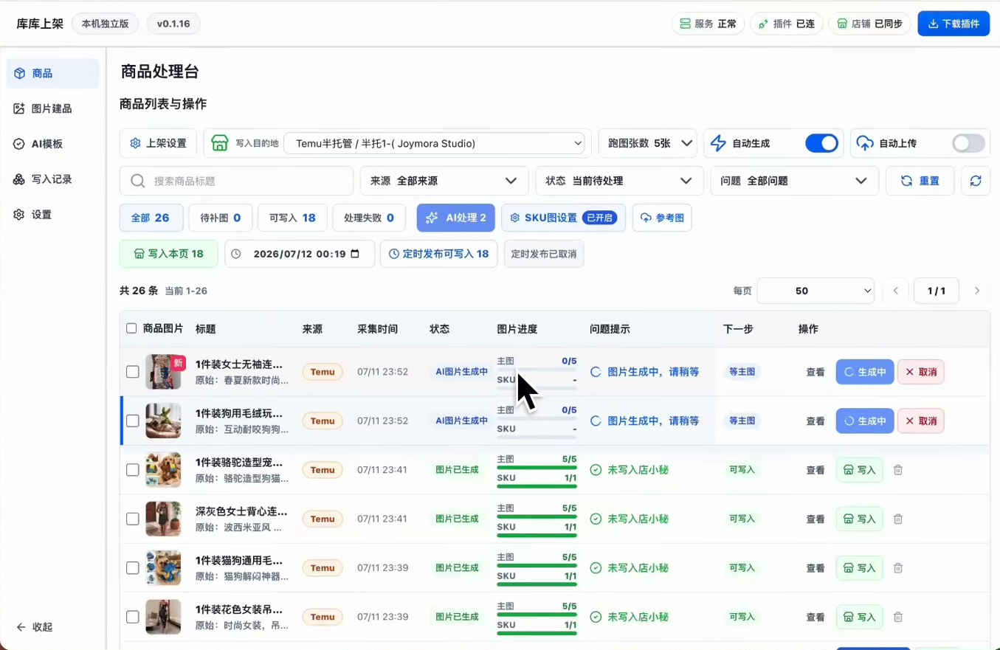
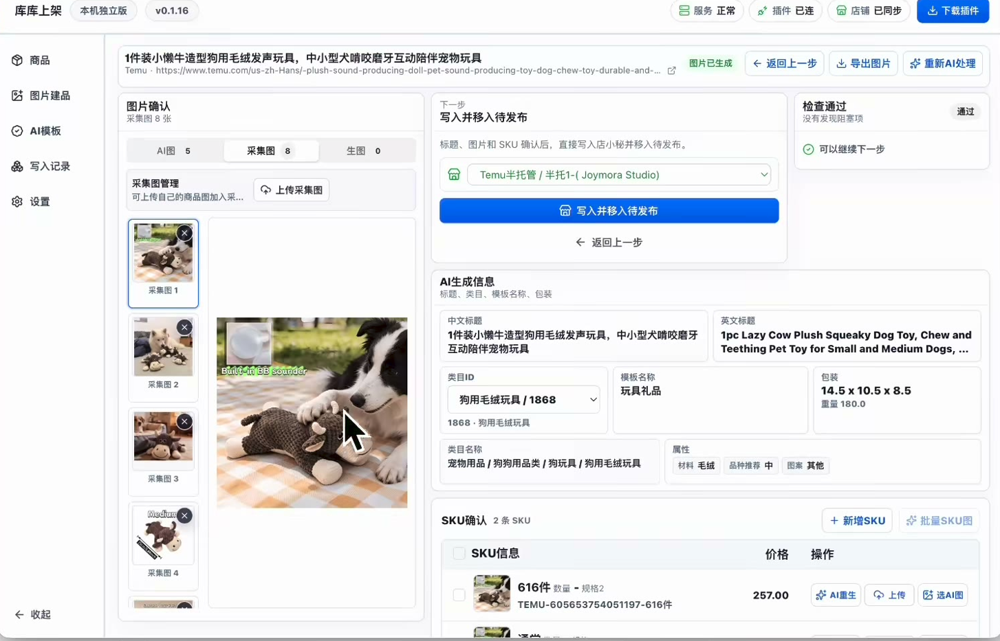

# TK 商品自动化工作台体验修复 Spec

**状态：** Draft，等待产品确认  
**日期：** 2026-07-21  
**基线：** `docs/superpowers/specs/2026-07-15-tk-commerce-workbench-greenfield-design.md`  
**目标：** 在不扩大 MVP 范围的前提下，把已经跑通的 1688 → Canvas → 妙手链路整理成运营能顺畅使用的商品处理台。

## 1. 背景

当前系统已经具备基础能力：浏览器扩展可以把 1688 勾选商品提交到本地工作台，后台可以执行采集、标题处理、Canvas 生图和妙手编辑相关流程。但当前前端仍偏“工程验收台”：状态文案、按钮可用性、进度展示和配置生效关系不够清楚。

对标产品的核心价值不是视觉样式，而是把运营动作组织成一条可理解的流水线：

```text
采集商品 → 商品池筛选 → AI 生图/标题处理 → 问题检查 → 人工确认 → 写入妙手
```

### 1.1 对标产品参考结论

参考帧图来源：`D:\project\dy-xiazai\frames`。

对标产品使用的是店小秘/Temu 生态。我们的生态不同：本项目面向 TK 商品自动化，采集和写回依赖妙手 API/skill，生图依赖 Canvas `TK工作流`。因此只能借鉴自动化产品逻辑，不能照搬平台写入路径。

对标产品可借鉴的核心结构：

```text
类目/模板基建
→ 浏览器侧采集商品
→ 商品进入处理台
→ AI 根据类目分流到专属提示词和属性规则
→ 批量生成标题、属性和图片
→ 通过中间数据结构承载结果
→ 用户确认
→ 一键写入目标平台草稿/采集箱
```

对本项目的等价映射：

| 对标产品 | 本项目 |
| --- | --- |
| 店小秘/Temu | 本地 TK 工作台 + 妙手 |
| Temu 商品链接采集 | 1688 商品链接采集 |
| 店小秘采集箱/待发布商品 | 妙手 canonical 公共采集箱商品 |
| AI 模板/类目属性 | 本地处理规则：标题规则 + Canvas `TK工作流` 绑定说明 |
| AI 生成图片 | Canvas `TK工作流` 输出 5 张图 |
| Excel/表格中转 | PostgreSQL 商品修订、Listing 草稿、图片资产和审批快照 |
| 一键写入店铺 | 用户确认后编辑回同一条妙手 canonical 公共采集箱商品 |

需要吸收的产品能力：

- 商品列表必须显示图片进度，例如 `0/5`、`5/5`、SKU 图进度；
- 每个商品必须有明确下一步，例如生成中、查看、确认写入、重试；
- 处理规则只保留标题规则和 Canvas `TK工作流` 绑定说明；
- AI 生成结果必须先进入可检查的中间态，不能直接写入外部平台；
- 写入前必须有轻量人工复核。

不能照搬的地方：

- 不使用 Excel 作为事实来源，本项目以 PostgreSQL 和本地图片资产为事实来源；
- 不写入店小秘/Temu，而是编辑妙手 canonical 公共采集箱商品；
- 不把“自动上传”默认打开到 TikTok 发布；
- 不绕过“开始处理”和“最终确认”两个边界。
- MVP 不在本地维护类目属性默认值；属性以妙手采集结果为准，只做翻译、清洗、格式校验和缺失提示。
- MVP 不在本地维护 Canvas 参考图和生图风格；产品识别和风格由 Canvas `TK工作流` 内部处理。

### 1.2 前端 UI 参考方向

产品确认：对标产品的功能组织和前端 UI 方向可以作为本次体验修复的重要参考。

商品处理台主列表参考：



本项目应吸收以下 UI 结构：

- 左侧固定导航：商品、处理规则、写入记录、设置；
- 顶部状态区：服务状态、扩展连接状态、妙手/店铺同步状态、插件下载/安装入口；
- 商品工作台主区：目标店铺、跑图张数、自动生成开关、自动上传/写入开关；
- 筛选工具条：搜索标题、来源筛选、状态筛选、问题筛选、重置/刷新；
- 状态 Tab：全部、待处理、自动处理中、待确认、需要人工处理、已完成；
- 批量操作条：批量开始处理、批量确认写回、批量重试；
- 商品表格：商品图片、标题、来源、采集时间、业务状态、图片进度、问题提示、下一步、操作；
- 行内主动作：生成中、查看、取消、写入、重试、删除；
- 详情/确认页：左侧图片确认，中间标题/属性/类目/SKU，右侧检查结果和下一步；
- 处理规则页：管理标题规则、目标语言风格、禁词/保留词，并展示 Canvas `TK工作流`、输入上限 9 张、输出 5 张。

商品列表到详情页的交互约束：

商品详情 / 图片确认页参考：



- 点击商品图片进入该商品的“商品详情 / 图片确认页”；
- 点击行内“查看”进入同一个“商品详情 / 图片确认页”；
- 商品列表不承载复杂编辑，只承载状态判断、批量选择和必要主动作；
- 商品详情 / 图片确认页承载运营复核：图片、标题、属性、SKU、价格、检查结果和最终写回动作；
- 自动处理中状态下，详情页只展示进度、输入图、生成结果占位和阻断原因，不展示外部写回动作；
- 只有处理完成并通过检查后，详情页才展示“确认写回妙手”的主动作。

本项目需要做出的差异化调整：

- 页面文案使用 TK/妙手语义，不出现店小秘、Temu 写入路径；
- “自动上传”在 MVP 中应表达为“确认后写回妙手”，默认不得绕过最终确认；
- 商品处理台是主入口，任务中心不进入主导航，降级为“设置 → 系统诊断 / 任务日志”；
- Excel 中转在 UI 上可作为“表格化预览”的交互参考，但底层事实来源仍是数据库和本地资产；
- 图片进度必须对应 Canvas `TK工作流` 的真实输入/输出，不只做视觉占位；
- 写入状态必须区分“已采集到妙手”和“已编辑回 canonical 妙手公共采集箱商品”。

本次修复的目标是让用户一眼知道：

- 当前商品到了哪一步；
- 哪些商品可以继续处理；
- 哪些商品失败以及失败原因；
- 下一步应该点什么；
- Canvas 和妙手是否真实接通。

## 2. MVP 修复成功定义

本次修复的验收终点是：

```text
1688 勾选商品
→ 提交到本地工作台
→ 采集完整商品信息
→ 清洗标题 / 生成目标语言 Listing
→ 调用本地 Canvas 8123 的 TK工作流生成 5 张图
→ 图片和标题回到商品工作台可预览
→ 用户确认后编辑回同一条 canonical 妙手公共采集箱商品
```

成功不等于“数据库里有状态”。成功必须同时满足：

- UI 可见：商品列表、详情页或确认页能看到处理后的标题和图片；
- 状态可懂：运营用户能看到业务状态，而不是只看到 `success`、`ready`、`succeeded`；
- 操作可继续：每个商品都有清楚的下一步按钮；
- 链路真实：Canvas 使用 `TK工作流`，妙手写入同一条 canonical 公共采集箱商品；
- 失败可解释：失败商品能看到失败环节和可恢复动作。

## 3. 不做范围

本次不扩大到以下能力：

- 不自动发布到 TikTok Shop；
- 不接入多用户、登录、权限或团队协作；
- 不做 SaaS 化部署；
- 不新增 Shopee、Ozon 等平台；
- 不把图片永久迁移到云存储；
- 不做无确认的全店自动采集；
- 不绕过“开始处理”这个费用边界；
- 不绕过最终人工确认直接写入妙手。

## 4. 开发前 6 个 Gate

### Gate 1：冻结 MVP 修复验收目标

必须明确本次只修复“运营链路不顺畅”的问题。验收以真实本地链路为准：

- 本地 Web：`http://127.0.0.1:3000`；
- 本地 Canvas：`http://127.0.0.1:8123`；
- Canvas 画布：TK；
- Canvas 工作流：`TK工作流`；
- Canvas 期望输出：5 张图；
- 妙手终点：编辑同一条 canonical 妙手公共采集箱商品，不自动认领到 TikTok 采集箱，不自动发布 TikTok。

### Gate 2：现状审计

开发前必须审计当前实现，输出“确认问题”和“非问题”。重点检查：

- 商品工作台主 UI 是否集中在 `apps/web/src/components/products/product-workbench.tsx`；
- 商品详情页是否只是摘要页，还是完整可编辑工作区；
- “开始处理”“批量开始处理”“确认写回妙手”是否真实触发后端流程；
- 设置页展示的 Canvas 工作流字段是否真实影响 Worker；
- Worker 是否读取 `.env`、数据库 plan，还是前端设置；
- 当前 `/api/v1/settings` 显示的 adapter mode 是否与 Worker 真实运行一致；
- Canvas 是否实际调用本地 8123 的 `TK工作流`；
- 妙手编辑是否作用于 canonical 公共采集箱商品，而不是创建重复商品；
- UI 状态是否只显示技术状态，导致用户不知道下一步。

审计结论不能用“可能”。不确定的项必须通过代码、数据库、接口、日志或真实操作确认。

### Gate 3：定义业务状态机

UI 不能直接暴露内部轴状态。需要把技术状态映射成运营状态。

产品确认：本项目核心理念是自动化优先，不应该给每个中间状态都设计人工按钮。默认流程应自动推进；只有费用边界、外部写入边界和异常恢复才需要用户动作。

人工动作只保留三类：

1. **开始处理**：费用边界。点击后才允许 LLM、定价、选图和 Canvas 生图；
2. **确认写回妙手**：外部写入边界。点击后才允许编辑同一条 canonical 妙手公共采集箱商品；
3. **异常处理**：缺图、缺配置、Canvas 失败、妙手结果未知等情况下查看原因或重试。

MVP 业务状态：

| 业务状态 | 用户含义 | 是否自动推进 | 主动作 |
| --- | --- | --- |
| 待处理 | 商品已进入工作台，还没有消耗模型或生图费用 | 否 | 开始处理 |
| 自动处理中 | 系统正在采集详情、归档图片、清洗标题、定价、选图或 Canvas 生图 | 是 | 无主按钮，只显示进度 |
| 待确认 | 标题、价格、图片和风险检查已准备好，等待人工复核 | 否 | 查看并确认 |
| 写回妙手中 | 用户已确认，系统正在编辑 canonical 妙手公共采集箱商品 | 是 | 无主按钮，只显示进度 |
| 已完成 | 已编辑回 canonical 妙手公共采集箱商品，MVP 流程完成 | 否 | 查看记录 |
| 需要人工处理 | 缺少信息、外部结果未知或某环节失败 | 否 | 查看原因 / 重试 |

推荐技术状态映射：

| 条件 | 业务状态 | UI 展示重点 |
| --- | --- | --- |
| `miaoshouEdit=succeeded` | 已完成 | 已写回妙手、canonical detail ID、写入记录 |
| `miaoshouEdit=queued/syncing` 或 `approval=approved` 且未成功 | 写回妙手中 | 妙手同步进度 |
| `assetArchive=ready` + `listing=ready` + `canvas=succeeded/partial_with_outputs` + `approval=unapproved` | 待确认 | 生成图、标题、价格、风险检查 |
| `automation=queued/running/ready` 或 `assetArchive=downloading` 或 `listing=generating` 或 `canvas=queued/running` | 自动处理中 | 当前环节、图片进度、预计下一步 |
| `automation=not_started` 且 `miaoshouSource=success/skipped_duplicate` 且有 canonical detail ID 和来源图片 | 待处理 | 开始处理 |
| 任一关键环节 `failed/needs_input/result_unknown`，或缺少 canonical detail ID / 来源图片 / 必需配置 | 需要人工处理 | 用户可读原因和恢复建议 |

技术状态仍然保留在详情、日志或诊断视图中，但商品列表默认展示业务状态。

按钮规则：

| 业务状态 | 主按钮 |
| --- | --- |
| 待处理 | 开始处理 |
| 自动处理中 | 不显示主按钮，显示进度 |
| 待确认 | 查看并确认 |
| 写回妙手中 | 不显示主按钮，显示进度 |
| 已完成 | 查看记录 |
| 需要人工处理 | 查看原因 / 重试 |

失败提示需要翻译成人话：

| 技术原因 | 用户提示 |
| --- | --- |
| `canonicalSuccessDetailId` 缺失 | 缺少妙手采集箱详情 ID，无法写回 |
| `canvas_zero_valid_outputs` | Canvas 没有返回可用图片 |
| `canvas_daily_limit` | 今日 Canvas 生图次数已达上限 |
| `template_reference_unavailable` | Canvas 工作流需要的模板素材未准备好 |
| `reconcile_required` | 外部结果未知，需要人工对账 |
| `staging_failed` | 图片临时上传失败，请重试 |
| `approval_invalidated` | 商品内容已修改，需要重新确认 |

### Gate 4：重设计商品工作台信息架构

产品确认：Gate 4 信息架构按以下规则冻结。

页面职责：

- 商品工作台：运营主入口，承载筛选、批量操作、商品进度；
- 商品详情页：承载原始信息、处理后标题、生成图、价格、问题、确认动作；
- 任务中心：从左侧主导航移除，降级为“设置 → 系统诊断 / 任务日志”，只做后台任务诊断、失败恢复和日志追踪，不作为运营主入口；
- 设置页：只放真实会影响运行的配置，不能出现“看起来可配但实际不生效”的字段；
- 处理规则页：不是复杂模板库。MVP 只管理标题规则、目标语言风格、禁词/保留词，并展示 Canvas `TK工作流`、输入上限 9 张、输出 5 张；不配置属性默认值、参考图或生图风格。

左侧主导航：

- 商品；
- 处理规则；
- 写入记录；
- 设置。

商品工作台状态 Tab：

- 全部；
- 待处理；
- 自动处理中；
- 待确认；
- 需要人工处理；
- 已完成。

商品工作台批量操作：

- 批量开始处理；
- 批量确认写回；
- 批量重试。

不在批量操作条堆叠低频按钮。删除、清空、导出、查看日志等动作应放入更多菜单、详情页或系统诊断中，避免主流程按钮过多。

商品列表最少需要展示：

- 商品图片；
- 标题；
- 来源；
- 采集时间；
- 业务状态；
- 图片进度，例如 `主图 5/5`、`SKU 1/1`；
- 问题提示；
- 下一步；
- 操作按钮。

商品详情 / 图片确认页布局参考对标产品，但语义必须使用 TK/妙手：

- 左侧：图片确认区，展示原图、Canvas 生成图、SKU 图和图片进度；
- 中间：商品内容区，展示并复核标题、属性、类目、SKU、价格；
- 右侧：检查结果和下一步，展示风险、缺失项、失败原因、推荐动作，以及“确认写回妙手”主按钮；
- 自动处理中时，详情页只显示进度和占位，不显示“确认写回妙手”；
- 只有状态进入“待确认”并通过基础检查后，才显示“确认写回妙手”。

设置页配置边界：

- 妙手连接与写回模式；
- Canvas 地址和 `TK工作流` 连接状态；
- LLM 配置；
- 默认目标语言；
- 定价公式；
- 系统诊断 / 任务日志入口。

设置页不得出现保存后不影响运行的“假配置”。如果某字段必须依赖 `.env` 或 Worker 重启，应明确标注“需要重启后生效”。

异常恢复体验：

- 每个异常必须显示失败环节；
- 每个异常必须显示用户可读原因；
- 每个异常必须给出推荐动作：重试、重新采集、检查配置、查看任务日志；
- 需要人工介入的商品统一进入“需要人工处理” Tab。

### Gate 5：准备固定验收商品集

至少准备以下验收样本：

| 样本 | 用途 |
| --- | --- |
| 单商品详情 URL | 验证完整成功链路 |
| 1688 店铺/搜索批量页 | 验证扩展扫描、勾选和只提交已选 |
| 多 SKU 商品 | 验证 SKU 图、规格和价格映射 |
| 图片不足商品 | 验证 Canvas 输入不足和降级提示 |
| 异常商品 | 验证失败状态、重试和错误提示 |

固定样本用于每轮开发后回归，避免只凭一次偶然成功判断通过。

当前固定样本：

| 样本类型 | 状态 | URL / 构造方式 | 验收重点 |
| --- | --- | --- | --- |
| 单商品详情 URL A | 已提供 | `https://detail.1688.com/offer/1013001591920.html?spm=a26352.13672862.offerlist.74.64241e62GBUfEO&cosite=-&tracelog=p4p&_p_isad=1&clickid=d609322de4c446eb9c7ad5f32c7264ef&sessionid=79d7417242becda81904b0b6debcf258` | 验证完整主链路和付费广告来源参数下的 URL 规范化 |
| 单商品详情 URL B | 已提供 | `https://detail.1688.com/offer/892408514788.html` | 验证历史主链路样本，便于和此前实测结果对比 |
| 1688 搜索批量页 | 已提供 | `https://s.1688.com/selloffer/offer_search.htm?keywords=%BC%D2%BE%DF%D7%B0%CA%CE%B0%DA%BC%FE&spm=a26352.13672862.searchbox.0` | 验证扩展扫描、批量勾选、只提交已选商品 |
| 多 SKU 商品 | 当前样品覆盖 | 从上述单商品和批量搜索样品中选择实际带多 SKU 的商品 | 验证 SKU 图、规格、价格区间和属性映射 |
| 图片不足商品 | 系统构造 | 用测试夹具构造 Canvas 输入不足或有效图不足场景 | 验证 Canvas 输入不足、降级提示和人工处理入口 |
| 异常商品 | 系统构造 | 用测试夹具构造：Canvas 无输出、妙手 ID 缺失、外部结果未知 | 验证失败状态、重试、系统诊断和任务日志入口 |

产品确认：Gate 5 暂以当前样品集作为固定验收集，不继续要求补充真实商品链接。真实链路用上述两个详情页和一个批量搜索页验证；边界异常用系统构造样本验证。

### Gate 6：输出实施计划

Spec 确认后，才拆实施计划。实施计划必须包含：

- 任务拆分；
- 涉及文件；
- 数据库/合同是否变更；
- 是否需要迁移；
- 每个任务的验收命令；
- UI 验收点；
- 真实链路验收点；
- 不允许越权修改的范围。

## 5. 产品原则

### 5.1 商品工作台优先

用户主要看商品，不是看任务。任务是后台执行细节。运营主页面应围绕商品组织，而不是围绕 job ID 或技术状态组织。

### 5.2 下一步必须明确

每一行商品都应该有一个主动作：

- 开始处理；
- 查看进度；
- 查看详情；
- 确认写入；
- 重试；
- 已完成。

不能让用户通过猜状态来判断下一步。

### 5.3 自动化必须可控

扩展提交商品后，可以自动完成只读采集和入池；但 LLM、Canvas、生图和妙手写入仍受边界控制：

- “开始处理”控制模型和 Canvas 成本；
- “确认写回妙手”控制外部写入。

### 5.4 配置必须真实生效

设置页展示的字段必须满足两条之一：

- 保存后会影响后续 Worker 运行；
- 明确标注“仅展示，需要重启 Worker 或改 env 才生效”。

不能保留“看起来可配置，实际没有接入运行时”的字段。

## 6. 待审计风险

以下风险必须在实施前确认：

1. 前端设置返回的 `externalAdapterMode` 与 Worker 真实运行模式可能不一致；
2. Canvas 工作流字段可能只是 UI 保存值，Worker 仍读 `.env`；
3. 商品详情页可能无法承担最终人工确认；
4. 当前状态投影可能不能表达“可写入妙手”和“已同步妙手”的差异；
5. 图片生成结果可能存在本地归档但 UI 不展示；
6. 妙手写入可能需要确认是编辑 canonical 商品，而不是重复创建；
7. 扩展提交和 Web 工作台之间可能缺少用户可见反馈。

## 7. 验收方式

本次修复最终必须通过三类验收。

### 7.1 静态验收

- spec 与 plan 已更新；
- 状态映射表存在；
- 设置字段与运行时来源说明清楚；
- 不做范围没有被突破。

### 7.2 自动化验收

至少运行：

```bash
pnpm test
pnpm typecheck
pnpm lint
pnpm build
```

如某项存在既有失败，必须明确失败是否与本次修复相关。

### 7.3 真实链路验收

真实跑一遍：

```text
1688 勾选商品
→ 扩展提交
→ 3000 商品工作台出现商品
→ 点击开始处理
→ Canvas 8123 / TK工作流生成 5 张图
→ UI 显示生成图和清洗标题
→ 人工确认
→ 妙手公共采集箱商品被编辑
```

验收报告必须写入 `docs/superpowers/reports/`。

## 8. 当前跟踪状态

| Gate | 状态 | 说明 |
| --- | --- | --- |
| Gate 1 冻结 MVP 修复验收目标 | 已通过 | 成功定义已收窄为“编辑同一条 canonical 妙手公共采集箱商品”，不自动认领、不自动发布 TikTok |
| Gate 2 现状审计 | 已通过 | 审计报告已确认当前 UI/productization 缺口、settings/runtime split、Canvas 8123 可用和 canonical 妙手编辑路径 |
| Gate 3 业务状态机 | 已通过 | 状态机已收敛为“自动化优先、少按钮”：待处理、自动处理中、待确认、写回妙手中、已完成、需要人工处理 |
| Gate 4 商品工作台信息架构 | 已通过 | 主导航、商品表格字段、状态 Tab、批量操作、详情页三区布局、设置页边界和异常恢复体验已由产品确认 |
| Gate 5 固定验收商品集 | 已通过 | 已确认两个单商品详情页、一个 1688 批量搜索页；多 SKU 由当前样品覆盖，图片不足和异常样本用系统构造 |
| Gate 6 实施计划 | 未开始 | Gates 1-5 已通过，下一步输出实施计划 |
